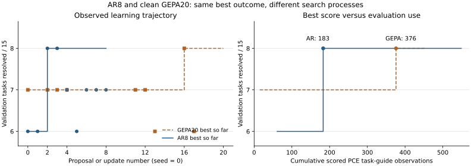

# AR8 and clean GEPA20 learning comparison

Both completed runs reached **8/15 validation tasks resolved**, with exactly
the same eight successes and seven failures. AR reached that result earlier
in its search and selected a substantially shorter guide. It did not improve
the best observed task coverage. These are single-run observations under
different seeds, artifact formats and evaluation schedules.

## Experiment identities and evidence

| Arm | Frozen runtime config | Result directory under remote `run_state/output/SWE-RPG/` |
|---|---|---|
| AR8 | [`autoresearch_pce_rpg_formal8_v1_20261118.yaml`](../../configs/autoresearch_pce_rpg_formal8_v1_20261118.yaml) | `autoresearch-pce-rpg-formal8-v1-20261118` |
| Clean GEPA20 | [`gepa_safe_pce_rpg_codex_reflection_diag20_v1_20261106.yaml`](../../configs/gepa_safe_pce_rpg_codex_reflection_diag20_v1_20261106.yaml) | `safe-pce-rpg-codex-reflection-diag20-v1-20261106` |

AR authority is `private/state.json`, the nine frozen
`analysis_inputs/guides/*.md`, `private/round-*-train.json`,
`private/round-*-validation.json`, and the Agent's `research_workspace/results.tsv`.
GEPA authority is its final candidate metrics, proposal artifacts, saved search
state and canonical PCE records. The derived audit counts 455 observations,
excluding physical retries. Private comparison inputs and computation are
retained in `.local/operations/ar-gepa-stage-completion-20261120/` in the
primary checkout; original scientific payloads remain unchanged on HPC.

Both runs use the frozen repository-disjoint **46 train / 15 validation /
16 downstream test** split, original training-only references, Native
`gpt-6-sol/high`, the same official binary evaluator and the shared Safe PCE
execution path. The independent 16-task test split was not evaluated here.
Validation scores guide selection; they are not independent test estimates.

## What changed in the learning process

| Dimension | Clean GEPA20 | AR8 |
|---|---|---|
| Proposal author | Fresh Codex conversation for each proposal | Persistent Codex researcher, resumed across owner slices |
| Learning artifact | Complete checklist, at most 10 conditions with local guides; 48/96-token limits | Free-text guide, unrestricted organization and length |
| Training evidence available to learner | Current eight-task minibatch and its references | Complete completed training runs, references and history |
| Training score | Parent and proposal must be compared; strict improvement admits proposal to validation | Reported as evidence; no train-score admission gate |
| Validation visibility | Selection through GEPA's fixed aggregate score | Researcher receives aggregate score, never task-level validation evidence |
| Selection | Fixed outer search and candidate pool | Researcher keeps or discards, with an explicit simplicity preference on ties |
| Evaluation schedule | Seed validation, then 20 parent/proposal mini8 comparisons; only eight proposals reach validation | Seed and eight updates each receive full train46 and validation15 |
| PCE execution window | 8 cases | 5 cases, reduced for inode headroom |
| Seed | One placeholder checklist item with its guide | Six-word placeholder text |

The clean GEPA20 arm already uses **whole-candidate Codex reflection**;
it is not the older ACE operation/counter update loop. This comparison cannot
attribute differences to removing ACE counters. AR still receives training
scores and official PCE outcomes. The change removes the mandatory training
score gate and expands evidence continuity; it does not remove scoring noise.

P/C/E execution, split, model and official scoring are shared, but artifact
representation, Planner application-record instructions, seeds, context,
selection and concurrency differ. This is a comparison of two practical
learning systems, not an isolated optimizer-only ablation.

## Best results and evaluation use

| Metric | Clean GEPA20 | AR8 |
|---|---:|---:|
| Seed validation | 7/15 (46.7%) | 6/15 (40.0%) |
| Best validation | 8/15 (53.3%) | 8/15 (53.3%) |
| Gain over own seed | +1 task | +2 tasks |
| First best guide | Proposal 16, C7 | Update 2, private guide commit `12612fa` |
| Validation visits, including seed | 9 | 9 |
| Sum of successes across validation visits | 62/135 | 62/135 |
| Training PCE observations | 320 | 414 |
| Validation PCE observations | 135 | 135 |
| Total scored PCE observations | 455 | 549 |
| PCE observations through first 8/15 result | 376 | 183 |
| Selected guide body words | 583 | 170 |

PCE counts are scored task-guide observations, not unique tasks, tokens or
Slurm submissions. AR used **20.7% more total observations** across the entire
run, while reaching the common best after **51.3% fewer observations**. Both
facts matter: earlier discovery did not lead to a higher eventual score.
The aggregate 62/135 values are repeated evaluations of the same 15 tasks,
not 135 independent validation examples. Word counts exclude IDs, JSON keys
and Markdown headings; they include GEPA's conditions and local-guide text.

Points in the left panel are actual validation results. Rejected GEPA
proposals have no validation point; a best-so-far line does not impute their
unknown scores. Horizontal axes compare different proposal schedules.

GEPA completed optimization in approximately **28 h 54 min**. AR's first
recorded researcher session to final score took approximately **56 h 13 min**,
including operator interruptions and recovery; final bookkeeping was recovered
separately. AR's smaller window, additional observations and interrupted
execution prevent interpreting this elapsed-time difference as optimizer
compute efficiency. Full AR guide evaluations during the steadier middle
portion took roughly 4.1–4.7 hours.

## Observed learning behavior

GEPA admitted 8/20 proposals; 11 tied their parent minibatch score and one
scored lower. Across 160 within-task parent/proposal comparisons, **95 RR,
53 UU, 10 U-to-R and 2 R-to-U** outcomes were observed: 92.5% were unchanged.
An iteration-8 gain on OpenAI 1684 was offset by a regression on Matplotlib
30867, producing a tie and discarding the complete proposal. This proves that
a local improvement can be lost by aggregate candidate selection; it does not
prove that the discarded proposal would improve validation.

AR explicitly tested different hypotheses: broad evidence-grounded planning,
observable acceptance contracts, minimal causal fixes, boundary/precedence
tables, special input values, state flow and shorter variants. Its messages
attribute Update 2 to training failures involving supported public forms in
Falcon and Faker, rather than task-level validation evidence. Update 6 focused
on state changes and downstream consumers. These records establish the
researcher's reasoning and chosen experiments; they do not establish that a
particular sentence caused a downstream success.

AR retained Update 2, rejected the equally scoring but longer Update 3, and
restored Update 2 after later variants failed to beat 8/15. Update 3 had the
highest training score, **30/46**, but did not exceed Update 2 on validation.
The selected Update 2 scored **28/46**, below the seed's 29/46: one training
U-to-R gain accompanied two R-to-U regressions. This is direct evidence of
train/validation disagreement even without a training admission gate.

AR removes the minibatch admission gate but still selects complete guides by
aggregate validation. Discarding the longer Update 3 does not separately credit
its useful knowledge. Persistent history makes earlier ideas accessible for
reuse, as in Update 8's return to explicit public-form coverage, but does not
guarantee their accumulation in the selected guide. Updates 4–8 scored 6–7/15;
the wider search freedom produced no further best-score improvement after
Update 2.

Across all nine AR guides, **40/46 training tasks** and **12/15 validation
tasks** never changed binary outcome. GEPA validation outcomes were invariant
for 13/15 tasks. Most task outcomes remain insensitive to these guide changes;
this alone cannot distinguish insufficient planning changes from Coder noise,
evaluator coupling or task difficulty. AR broadens search freedom but has not
resolved those measurement and attribution limitations.

The earlier clean20 reading audit observed tool-output truncation in 19/20
reflection sessions and manual rereads. AR's complete-history availability
does not guarantee complete reading. Persistent context and free reading are
opportunities, not proof that tool truncation or information loss disappeared.

## Best candidates resolve the same tasks

| Validation task | GEPA seed | GEPA C7 | AR seed | AR Update 2 |
|---|---|---|---|---|
| PDM 2655 | U | U | U | U |
| PDM 2795 | R | R | R | R |
| PDM 3546 | R | R | R | R |
| PDM 3655 | U | U | U | U |
| pvlib 1962 | U | U | U | U |
| pvlib 2433 | R | R | U | R |
| pvlib 2521 | U | U | U | U |
| pvlib 2550 | R | R | R | R |
| pip 12799 | R | R | R | R |
| pip 12877 | U | U | U | U |
| pip 13064 | U | R | U | R |
| pip 13070 | U | U | U | U |
| pip 13124 | R | R | R | R |
| Reflex 2242 | R | R | R | R |
| Reflex 4239 | U | U | U | U |

R means resolved under the official evaluator; U means unresolved. AR's extra
gain relative to its own seed is pvlib 2433, which already succeeded with the
GEPA seed. Both best candidates also resolve pip 13064. The extra baseline
gain therefore does not demonstrate broader successful task coverage than
GEPA. Repeated runs or downstream holdout evaluation would be needed to
establish a reliable performance difference.

## Readability of the selected artifacts

GEPA C7 has ten high-level questions covering the observable contract,
reproduction, first divergent behavior, input distinctions, state ownership,
transformation scope, existing contracts, repository design, affected entry
points and verification. Each local guide explains concrete investigation
steps. The questions are readable, but the 583-word combined text includes
overlapping instructions and many conditional examples.

AR's 170-word selected body compresses the main advice into three paragraphs:
observable contract, affected code paths and concrete edits, then focused
verification. It contains no source-case names or repository symbols. The
result is easier to read as one planning guide. Its reduced detail about
state lifetime, input representation and transformation boundaries may also
omit useful distinctions from C7; equal scores do not establish that those
details are universally unnecessary.

The selected AR guide below is reproduced verbatim from frozen `0002.md`:

> # Implementation planning guide
>
> Start with the observable contract. List the behavior the request expects for its examples, accepted inputs, defaults, errors, and interactions with existing options. Preserve public forms that already work. If the request suggests multiple compatible forms, account for each instead of silently narrowing the interface. Resolve ambiguity using repository docs, tests, and conventions; state any remaining assumption.
>
> Trace the relevant code path and nearby tests before proposing a change. Give the coder a short sequence of concrete edits, naming the files and functions that matter and the behavior each edit must produce. Include adjacent paths that share the API, such as wrappers, asynchronous versions, type declarations, or documentation when applicable. Keep implementation choices flexible where the contract does not require one design.
>
> End with focused verification: reproduce the reported case, test each accepted form and important boundary, then run the nearby existing tests to catch regressions. Specify the expected outcome of each check. Keep the plan concise and grounded in what you observed; do not write code in the plan.

## Complete score histories

AR scores are full fixed-set counts. Keep/discard entries are the researcher's
own recorded choices, not Host modifications to scientific outputs.

| Update | Train resolved | Validation resolved | Best validation | Recorded choice |
|---|---:|---:|---:|---|
| Seed | 29/46 | 6/15 | 6/15 | Keep baseline |
| 1 | 29/46 | 6/15 | 6/15 | Discard |
| 2 | 28/46 | 8/15 | 8/15 | Keep |
| 3 | 30/46 | 8/15 | 8/15 | Discard, longer tie |
| 4 | 28/46 | 7/15 | 8/15 | Discard |
| 5 | 28/46 | 6/15 | 8/15 | Discard |
| 6 | 28/46 | 7/15 | 8/15 | Discard |
| 7 | 29/46 | 7/15 | 8/15 | Discard |
| 8 | 27/46 | 7/15 | 8/15 | Discard |

GEPA minibatches differ between proposals. A parent count from one row is
not a full-training estimate comparable to another row or to AR's train46.

| Proposal | Parent mini | Proposal mini | Pool candidate | Validation resolved | Admission |
|---|---:|---:|---|---:|---|
| Seed | — | — | C0 | 7/15 | Baseline |
| 1 | 6/8 | 6/8 | — | — | Tie |
| 2 | 5/8 | 6/8 | C1 | 7/15 | Admit |
| 3 | 4/8 | 6/8 | C2 | 7/15 | Admit |
| 4 | 5/8 | 6/8 | C3 | 7/15 | Admit |
| 5 | 4/8 | 4/8 | — | — | Tie |
| 6 | 3/8 | 3/8 | — | — | Tie |
| 7 | 4/8 | 4/8 | — | — | Tie |
| 8 | 7/8 | 7/8 | — | — | Tie |
| 9 | 6/8 | 5/8 | — | — | Loss |
| 10 | 5/8 | 5/8 | — | — | Tie |
| 11 | 5/8 | 6/8 | C4 | 7/15 | Admit |
| 12 | 5/8 | 6/8 | C5 | 7/15 | Admit |
| 13 | 6/8 | 7/8 | C6 | 6/15 | Admit |
| 14 | 6/8 | 6/8 | — | — | Tie |
| 15 | 2/8 | 2/8 | — | — | Tie |
| 16 | 5/8 | 6/8 | C7 | 8/15 | Admit |
| 17 | 3/8 | 4/8 | C8 | 6/15 | Admit |
| 18 | 7/8 | 7/8 | — | — | Tie |
| 19 | 6/8 | 6/8 | — | — | Tie |
| 20 | 3/8 | 3/8 | — | — | Tie |

## Terminal recovery and retention

AR's nine scores were complete before its last original owner timed out during
bookkeeping. The reviewed finalization fix at `31ede65` resumed the same Native
session, recorded the missing TSV row and restored the already evaluated
Update 2. Recovery job **6371567** completed on 20 November 2026. All nine
guide hashes, the score-state hash, the original TSV prefix and metadata for
all 549 canonical outputs remained unchanged; no new PCE was run.

The existing cleanup operator was used after both clusters and the local
Supervisor were confirmed idle. Both selected staging roots had zero retained
submission `workdir` copies; their PCE trees contained no residual `workspaces`
or `prepared_repository` copies. Fixed source provenance, outputs, checkpoints,
trajectories, SIFs and prepared history remain retained. This is a check of
these two formal runs, not a claim of a new project-wide storage inventory.
Terminal Supervisor launch YAMLs are archived byte-for-byte under
`configs/archive/supervisor_launches/`; scientific runtime configs remain in
their original locations.
